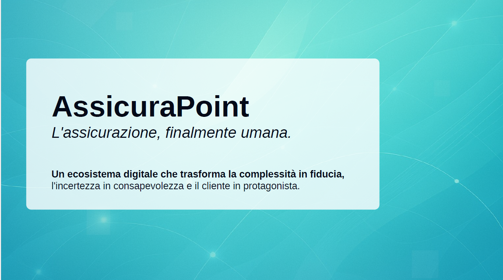

# Presentazione Progetto AssicuraPoint

---

### **Slide 1: Titolo**

---

### **Slide 2: Il Problema - Un'Opportunità Nascosta**

Il settore assicurativo oggi vive un paradosso: da un lato, **una solida stabilità finanziaria**; dall'altro, **una profonda disconnessione con il cliente moderno**. I processi sono percepiti come **complessi, burocratici e impersonali**. Parla una lingua che i clienti non capiscono, propone processi lenti e genera più ansia che sicurezza.

Questa non è una semplice  opinione. **È il risultato di un'analisi approfondita.**

Il progetto nasce da una **ricerca meticolosa**, i cui risultati sono interamente documentati e consultabili nella cartella `/docs` della repository GitHub. All'interno, troverete un'analisi che mappa **oltre 20 criticità sistemiche del settore**, ciascuna supportata da fonti reali.

Da questa analisi emerge un'opportunità chiara: colmare il divario tra le assicurazioni e le persone.

---

### **Slide 3: La Nostra Visione**

La nostra visione è trasformare l'assicurazione **da un obbligo percepito a un'esperienza di valore.**

Vogliamo creare un percorso dove il cliente si senta compreso, protetto e in pieno controllo. Lo facciamo attraverso una piattaforma progettata per essere:

* **Semplice**: Abbattiamo la complessità, sostituendo il gergo tecnico con un dialogo chiaro e guidato.
* **Umana**: Mettiamo al centro l'individuo, le sue emozioni e i suoi bisogni, non il contratto.
* **Intelligente**: Usiamo la tecnologia non come fine, ma come mezzo per offrire personalizzazione reale, trasparenza ed efficienza.

---

### **Slide 4: Allineamento Strategico con Assicurapoint.it**

Questa visione non è solo nostra. **È la naturale evoluzione digitale della filosofia di Assicurapoint.it**.

Assicurapoint.it mira a diventare un "punto di riferimento Assicurativo e Finanziario" offrendo "prodotti estremamente personalizzati" e dotando i propri collaboratori del "migliore gestionale" per ridurre i tempi e dedicarsi alla consulenza.

Il nostro progetto sposa pienamente questi valori, portandoli al livello successivo. Creiamo gli strumenti digitali per **realizzare su larga scala la promessa di personalizzazione, efficienza e centralità del cliente** che è già nel DNA della vostra azienda.

---

### **Slide 5: L'Architettura della Soluzione: Le 3 Macro-Aree**

Per realizzare questa visione, ho strutturato la piattaforma in **tre macro-aree strategiche**, che guidano l'intero ciclo di vita del cliente:

1. 🌐 **Attrarre e Convertire (Portale Pubblico)**: È il primo punto di contatto. Qui non vendiamo, ma educhiamo e guidiamo, trasformando l'incertezza in consapevolezza. Attraverso strumenti come il **Consulente Digitale Empatico** e il **Simulatore di Crisi 3D**, aiutiamo l'utente a comprendere i propri rischi e il valore della protezione, in modo interattivo e senza pressioni.
2. 📊 **Gestire i Clienti (Dashboard Cliente)**: È il cuore dell'esperienza post-acquisto. Dove il cliente è protagonista attivo della sua protezione, con strumenti semplici e potenti. Qui può costruire e adattare la sua protezione in tempo reale con il nostro **Costruttore di Polizze Modulari**, partecipare a percorsi di **gamification** che premiano i comportamenti virtuosi e gestire i sinistri in modo semplice e trasparente.
3. 👨‍💼 **Potenziare i Consulenti (Portale Interno)**: L'innovazione non è solo per il cliente. Forniamo ai consulenti una **Dashboard Cliente a 360°** che offre una visione completa, dall'analisi emotiva allo storico delle interazioni. Dove liberiamo i professionisti dalla burocrazia per restituirli alla consulenza di valore, potenziando la vostra rete.

---

### **Slide 6: Innovazione #1 - Una Consulenza Empatica e Intelligente**

Nella Macro-Area **"Attrarre e Convertire"**, introduciamo strumenti inediti:

* **Consulente Digitale con "Specchio Emozionale"**: Il nostro chatbot non solo risponde, ma *ascolta*. Analizza il tono e le parole per adattare la comunicazione, diventando più rassicurante se percepisce stress.
* **Mappa Predittiva dei Rischi di Quartiere**: Dati iper-locali per mostrare i rischi reali legati a un indirizzo specifico, rendendo la necessità di protezione tangibile e non generica.
* **Interfaccia Semplificata con "Modalità Nonno Felice"**: Un pulsante che trasforma l'interfaccia rendendola radicalmente accessibile a tutti, inclusi anziani e stranieri.

---

### **Slide 7: Innovazione #2 - Contratti e Polizze che Vivono con Te**

Nella Macro-Area **"Gestire i Clienti"**, rivoluzioniamo il concetto di polizza:

* **Contratti Interattivi con "Contratto Liquido"**: Basta PDF illeggibili. I nostri contratti si possono "interrogare" in linguaggio naturale. Chiedi "Cosa succede se mi rubano il PC?" e l'IA ti mostra la clausola esatta, tradotta in termini semplici.
* **Gestione Polizze Dinamica e Flessibile**: Polizze "camaleonte" che si adattano al tuo contesto, come attivare una copertura viaggio quando entri in aeroporto o aumentare temporaneamente un massimale in una zona a rischio.

---

### **Slide 8: Innovazione #3 - Sicurezza e Fiducia di Nuova Generazione**

Creiamo un nuovo standard di trasparenza e sicurezza:

* **Sigillo Biometrico di Accettazione Clausola**: Per le clausole più importanti, non un semplice click, ma una "firma" biometrica che garantisce piena consapevolezza e riduce il contenzioso.
* **Sistema Antifrode con "DNA Digitale dell'Incidente"**: Combiniamo biometria e blockchain. L'utente registra un video-racconto del sinistro e un'IA ne analizza la coerenza, creando uno "score di veridicità" notarizzato e immutabile.
* **Un meccanismo avanzato** che combina autenticazione biometrica e tracciamento blockchain. Ogni fase critica del contratto o del sinistro viene registrata in modo immutabile, riducendo drasticamente il rischio di frodi e aumentando la fiducia.

---

### **Slide 9: Innovazione #4 - Gestione Emergenze e Sinistri, Reinventata**

Trasformiamo il "momento della verità" da un'esperienza di stress a una di efficienza:

* **Assistente Vocale "SOS" Predittivo**: Non devi nemmeno chiedere aiuto. Se i sensori dello smartphone rilevano un impatto violento, l'app chiede "Stai bene?". In assenza di risposta, allerta automaticamente i soccorsi. Oppure un sistema di emergenza attivabile con un comando vocale. In caso di incidente, basta pronunciare una parola chiave per avviare la procedura di sinistro e allertare i soccorsi, unendo velocità e sicurezza.
* **Ricostruzione Sinistro in 3D con Realtà Aumentata**: In caso di incidente, i conducenti possono "scannerizzare" la scena con il telefono, creando un modello 3D oggettivo e incontestabile per accelerare la perizia.
* **Liquidazione Istantanea con IA Visiva**: Per piccoli danni, un'IA analizza un video inviato dall'utente e, se la perizia è positiva, invia il bonifico in meno di 5 minuti.

---

### **Slide 10: Innovazione #5 - Un Ecosistema di Valore, Oltre la Polizza**

Fidelizziamo il cliente creando un ecosistema che premia e supporta:

* **Gamification Etica**: Un'esperienza che premia la prudenza e la prevenzione, non la spesa, con "Badge delle Virtù". Un modulo che trasforma la gestione assicurativa in un gioco. Il cliente completa missioni, guadagna punti, sblocca badge e accede a premi. Questa dinamica ludica stimola la partecipazione, rende l’esperienza piacevole e rafforza la fidelizzazione.
* **Concierge della Prevenzione**: Un marketplace di servizi che non offre solo sconti, ma agisce proattivamente (es. "La revisione della caldaia scade, vuoi che prenotiamo un tecnico per te?"). Oppure uno spazio in cui i punti fedeltà accumulati possono essere spesi per servizi utili e concreti, come visite mediche, manutenzione auto o check-up casa, estendendo il valore della polizza a un ecosistema di servizi quotidiani.
* **Network Sociale Assicurativo**: Creiamo community dove i clienti possono scambiarsi consigli e accedere a polizze di gruppo.
* **Profilo di Rischio Etico**: Con il consenso, premiamo i comportamenti virtuosi (come il volontariato) con uno **"sconto etico"**.

---

### **Slide 11: La Visione Futura. Oltre l'Assicurazione, verso la Persona.**

Durante la progettazione, mi sono chiesta: come potremmo rendere questo mondo ancora più umano? Da qui è nata l'idea per il nostro prossimo orizzonte: **ScopriTeStesso**.

Un framework che unisce **introspezione e gamification**. Immaginate una sezione dove l'utente, attraverso mini-quiz di auto-riflessione, possa scoprire il proprio approccio al rischio e alla sicurezza.

**L'obiettivo non è vendere, ma aiutare a capire.**

---

### **Slide 12: Un Modello Etico e Sostenibile (Win-Win)**

Il framework **ScopriTeStesso** si basa su un modello etico **co-creativo, non manipolativo**:

1. **L'utente fa il quiz**: ottiene valore personale e consapevolezza.
2. **Può scegliere di condividere i risultati**: Se lo fa...
3. **Si crea un valore reciproco**:
    * **Noi conosciamo meglio il cliente**: offriamo prodotti e consigli davvero adatti alla sua personalità. *(Valore Aziendale)*
    * **L'utente riceve un beneficio reale**: sconti, punti extra o suggerimenti mirati. *(Valore Condiviso)*

Questo approccio trasforma la personalizzazione da uno strumento di vendita a un **dialogo basato sulla fiducia**.

---

### **Slide 13: Da Idea a Realtà. Un Progetto Già in Moto.**

AssicuraPoint non è solo un'idea. È un progetto con fondamenta solide e già in esecuzione.

Abbiamo sviluppato il cuore pulsante della piattaforma: il **Modulo Core & Identità**. Oggi abbiamo un MVP funzionante che gestisce:

* **Registrazione** e autenticazione sicura.
* Un flusso completo di **conferma via email** e **recupero password**.
* Integrazione con **login social (Google e Facebook)**.
* Una gestione del profilo utente protetta da autenticazione **JWT**.

Il nostro backend in **Node.js** e il frontend in **React** sono operativi. Questa base ci permette di accelerare lo sviluppo secondo una **roadmap chiara e progressiva**.

---

### **Slide 14: La Roadmap per il Futuro - Da MVP a Ecosistema**

Abbiamo una visione chiara e una roadmap progressiva per trasformare AssicuraPoint in una "super-app" assicurativa.

* **V1.0 - MVP & Onboarding (Oggi)**: Le fondamenta sono gettate. Il nostro obiettivo immediato è integrare il Consulente Digitale e il Costruttore di Polizze base.
* **V1.5 - Incentivi & Fidelizzazione**: Introdurremo la gamification e il programma "Invita un Amico" per stimolare la crescita e il coinvolgimento.
* **V2.0 - Espansione & Portabilità**: Lanceremo il "Passaporto Assicurativo Universale" e il marketplace di micro-polizze on-demand.
* **V3.0 e Oltre - Innovazione Totale**: Integreremo le tecnologie più avanzate: simulatori 3D, antifrode su blockchain, assistenza vocale "SOS" e strumenti predittivi per consulenti.
Ogni fase è progettata per aggiungere valore tangibile sia per il cliente che per il business, costruendo un ecosistema completo e scalabile.
* **🔹 V4.0 – Piattaforma Completa & Ecosistema**: AssicuraPoint diventa una **super-app assicurativa**: connessa, scalabile, sicura, gamificata, social e aperta a partner esterni, con un forte focus sull'accessibilità universale.

---

### **Slide 15: Il Valore per AssicuraPoint.it**

L'adozione di questo progetto porterà un valore strategico tangibile:

* **Leadership Tecnologica**: Posizionerà AssicuraPoint.it come il broker più innovativo e all'avanguardia del mercato italiano.
* **Fidelizzazione senza precedenti**: Creerà un'esperienza cliente talmente superiore da rendere la competizione sul prezzo irrilevante.
* **Efficienza Operativa**: Potenzierà la rete di consulenti con strumenti intelligenti, automatizzando le attività a basso valore e liberando tempo per la consulenza.
* **Accesso a Nuovi Mercati**: Grazie all'accessibilità e alla semplicità, attirerà segmenti di clientela oggi difficili da raggiungere (giovani, stranieri, anziani).

---

### **Slide 16: Conclusione**

AssicuraPoint è più di una piattaforma. **È una promessa.**

La promessa di un'assicurazione che finalmente parla la nostra lingua. Che ci capisce, ci premia e ci protegge in modo intelligente e proattivo.

Non stiamo semplicemente costruendo un'altra app; stiamo progettando **un nuovo modo di pensare e vivere l'assicurazione**, in perfetta sintonia con i valori e gli obiettivi di AssicuraPoint.it.

**Abbiamo una visione, un piano e il codice per realizzarla.**

Grazie per la vostra attenzione.